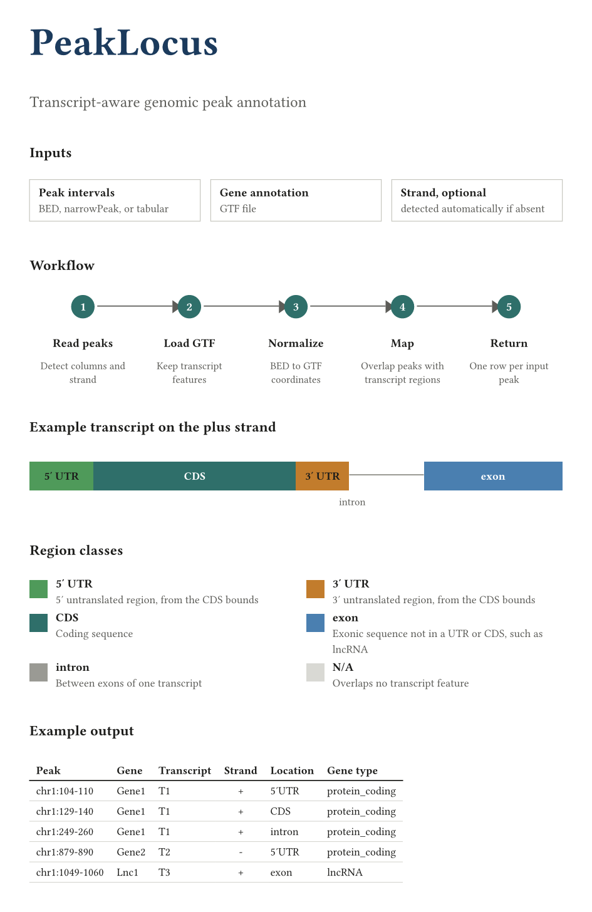

# PeakLocus

[](#citation)
[](#installation)
[](LICENSE)

**PeakLocus** is a zero-dependency Java command-line tool for **RNA-centric genomic peak and interval annotation**.



```text
RNA intervals + GTF
        |
        v
Coordinate and strand normalization
        |
        v
Transcript-aware GTF indexing
        |
        v
Overlapping gene/transcript candidates
        |
        v
Representative transcript selection
        |
        v
RNA-region assignment
        |
        v
3'UTR | 5'UTR | CDS | exon | intron | N/A
        |
        v
Gene + transcript + biotype + strand + location
```

---

## Purpose

PeakLocus was developed specifically for annotating **RNA-associated genomic coordinates**, rather than general DNA regulatory elements.

Its annotation vocabulary is intentionally restricted to transcript-relevant regions:

```text
3'UTR
5'UTR
CDS
exon
intron
N/A
```

PeakLocus does **not** annotate promoters, enhancers, nearest TSSs, chromatin states, or other DNA-regulatory features.

Typical inputs include:

- RNA modification calls
- direct RNA/Nanopore modification sites
- MeRIP-seq / m6A-seq peaks
- CLIP/RBP peaks
- RNA-associated MACS2/MACS3 peaks
- modkit BED/TSV output
- custom BED/TSV genomic intervals

---

## What PeakLocus adds

Every input row is preserved and PeakLocus appends:

```text
Gene_ID
Gene_Name
Transcript_IDs
Gene_Type
Transcript_Type
Gene_Strand
Location
```

For example:

```text
Gene_ID        ENSMUSG000000...
Gene_Name      Cd72
Transcript_IDs ENSMUST00000107926.9
Gene_Type      protein_coding
Transcript_Type protein_coding
Gene_Strand    -
Location       CDS
```

---

## Representative transcript selection

Genes frequently contain multiple transcript isoforms, and the same genomic interval can correspond to different RNA regions in different transcripts.

For example, one interval may be:

```text
canonical protein-coding transcript -> CDS
minor NMD transcript                 -> 3'UTR
```

PeakLocus therefore does **not** globally prioritize one RNA-region category over another across all overlapping transcripts.

Instead, transcript context is resolved first.

When transcript metadata are available, PeakLocus prioritizes biologically representative transcript models approximately as:

```text
GENCODE Primary / Ensembl canonical / MANE
                |
                v
APPRIS principal
                |
                v
other protein-coding transcripts
                |
                v
other transcript models
                |
                v
nonsense-mediated decay / non-stop decay
                |
                v
retained-intron / processed transcript models
```

These rankings are applied only when the corresponding metadata are present in the supplied GTF.

This prevents a minor transcript isoform from controlling the final annotation solely because it assigns the genomic interval to a different RNA-region class.

---

## RNA-region assignment

After representative transcript context has been established, PeakLocus determines the RNA region overlapping the query.

Possible assignments are:

```text
3'UTR
5'UTR
CDS
exon
intron
N/A
```

Within the selected transcript context, PeakLocus evaluates the amount of query sequence overlapping specific RNA-region annotations.

Specific transcript subregions such as:

```text
3'UTR
5'UTR
CDS
```

are retained instead of being reduced to the broader parent `exon` category.

For example:

```text
CDS overlap  = 100 bp
exon overlap = 100 bp
```

is reported as:

```text
CDS
```

because CDS provides the more specific transcript annotation.

If a query cannot be resolved to a specific UTR or CDS subclass but overlaps an annotated exon, it is reported as:

```text
exon
```

Introns are used when the query falls within transcript-derived intronic sequence and no exonic feature applies.

If no compatible transcript-region annotation is found:

```text
Location = N/A
```

---

## GENCODE-aware transcript ranking

GENCODE annotations frequently contain transcript-ranking metadata such as:

```text
tag "GENCODE_Primary";
tag "Ensembl_canonical";
tag "MANE_Select";
tag "appris_principal_1";
```

PeakLocus preserves repeated GTF `tag` attributes so that multiple transcript-ranking annotations can be used simultaneously.

This is important because GTF records may contain several `tag` fields for the same transcript.

---

## GENCODE-aware UTR annotation

GENCODE commonly uses the generic feature label:

```text
UTR
```

rather than always providing separate:

```text
five_prime_utr
three_prime_utr
```

records.

PeakLocus uses transcript-specific CDS boundaries together with transcript strand to determine whether a generic UTR corresponds to the 5' or 3' untranslated region.

For a `+` strand transcript:

```text
5'UTR -------- CDS ---------------- 3'UTR
```

For a `-` strand transcript:

```text
3'UTR -------- CDS ---------------- 5'UTR
```

PeakLocus automatically accounts for this reversed genomic orientation.

If a generic UTR cannot be reliably oriented because the transcript has no usable CDS boundaries, PeakLocus conservatively reports the region as:

```text
exon
```

rather than inventing a 5'/3' assignment.

---

## Transcript-aware introns

PeakLocus constructs introns from gaps between consecutive exons of each transcript independently.

Conceptually:

```text
Exon 1 -------- Intron -------- Exon 2
```

This differs from simply treating all non-exonic sequence inside a gene boundary as intronic.

Transcript-aware intron construction is especially important at alternatively spliced loci, where a region that is intronic in one transcript may be exonic in another.

---

## Automatic strand-column detection

The input does **not** need to place strand in a fixed column.

With the default:

```text
--strand-column auto
```

PeakLocus uses the following strategy:

1. **Header detection**  
   Headers containing strand-related terms are preferred, including names such as:

   ```text
   strand
   genomic_strand
   peak_strand
   read_strand
   transcript_strand
   ```

2. **BED6/MACS convention**  
   If column 6 contains strand-like values, it is recognized as the conventional BED/MACS strand field.

3. **Value-profile detection**  
   For headerless or custom tables, PeakLocus profiles columns and can identify an arbitrary column dominated by strand-like values.

4. **Safe unstranded fallback**  
   If no reliable strand column is found, PeakLocus does not invent one. The interval is treated as unstranded and both transcript strands are queried.

Accepted positive-strand values include:

```text
+
plus
forward
fwd
sense
```

Accepted negative-strand values include:

```text
-
minus
reverse
rev
antisense
anti-sense
```

Values such as:

```text
.
*
NA
N/A
none
unknown
unstranded
```

are treated as unstranded for that row.

At startup PeakLocus reports what it detected, for example:

```text
Strand column: 5
Strand detection: header-based detection: 'strand'
```

You can override automatic detection:

```bash
--strand-column 4
--strand-column genomic_strand
--strand-column none
```

Column numbers supplied on the command line are **1-based**.

---

## Supported input styles

PeakLocus accepts:

- tab-delimited files
- comma-delimited files
- whitespace-delimited files
- plain-text files
- gzip-compressed `.gz` files

Supported interval styles include:

```text
BED3
BED4
BED5
BED6
BED12
modkit BED/TSV
MACS2/MACS3 narrowPeak
MACS2/MACS3 broadPeak
CLIP/RBP peak files
m6A/MeRIP peak files
Nanopore/direct RNA modification intervals
custom RNA peak/interval tables
```

The input must contain chromosome, start, and end coordinates.

With headers, PeakLocus detects common coordinate names automatically.

Headerless BED-like files default to:

```text
column 1 = chromosome
column 2 = start
column 3 = end
```

Unusual layouts can be specified explicitly:

```bash
--chrom-column NAME_OR_NUMBER
--start-column NAME_OR_NUMBER
--end-column NAME_OR_NUMBER
```

---

## Coordinate systems

GTF coordinates are:

```text
1-based inclusive
```

BED and MACS coordinates are normally:

```text
0-based half-open
```

PeakLocus defaults to:

```text
--coordinates auto
```

BED-like inputs are recognized from common coordinate names, extensions, and file formats.

For example:

```text
BED: [start, end)
```

is converted internally to:

```text
GTF-compatible: [start + 1, end]
```

The original input coordinates are **not modified in the output**.

For custom 1-based inclusive tables:

```bash
--coordinates one-based
```

For explicitly BED-like inputs:

```bash
--coordinates bed
```

---

## Requirements

- Java 8 or newer
- a GTF annotation file
- no external Java dependencies

PeakLocus has been developed and tested with annotations including GENCODE and FlyBase GTF files.

---

## Installation

Clone the repository:

```bash
git clone https://github.com/gsarfo-boateng/PeakLocus.git
cd PeakLocus
```

Build PeakLocus:

```bash
./build.sh
```

The resulting executable JAR is:

```text
peaklocus-1.0.0.jar
```

---

## Quick start

```bash
java -jar peaklocus-1.0.0.jar -i modification_sites.bed -g gencode.vM39.primary_assembly.annotation.gtf -o modification_sites.peaklocus.tsv
```

Or use the included wrapper:

```bash
./run.sh -i modification_sites.bed -g gencode.vM39.primary_assembly.annotation.gtf
```

---

## Examples

### modkit-style table

```bash
java -jar peaklocus-1.0.0.jar -i examples/input/modkit_like.tsv -g examples/reference/mini.gtf -o modkit.peaklocus.tsv
```

If the input header contains `strand`, PeakLocus detects it automatically.

---

### Standard BED6

```bash
java -jar peaklocus-1.0.0.jar -i examples/input/bed6.bed -g examples/reference/mini.gtf
```

BED column 6 is automatically recognized as the strand field.

---

### Headerless file with strand in column 4

Input:

```text
chr1 104 110 + 9.5 p1
chr1 879 890 - 8.2 p2
chr1 1049 1060 + 7.1 p3
```

Run:

```bash
java -jar peaklocus-1.0.0.jar -i examples/input/headerless_strand_col4.txt -g examples/reference/mini.gtf
```

PeakLocus profiles the columns and can identify column 4 as strand.

---

### MACS2/MACS3 narrowPeak

```bash
java -jar peaklocus-1.0.0.jar -i examples/input/macs3.narrowPeak -g examples/reference/mini.gtf
```

MACS peak files commonly contain:

```text
.
```

in BED column 6.

PeakLocus recognizes the conventional strand field but treats `.` as unstranded and queries transcripts on both strands.

This support is intended for **RNA-associated peaks** called with MACS. PeakLocus remains an RNA annotation tool and does not add promoter or chromatin annotations.

---

## Command-line options

```text
-i, --input FILE
-g, --gtf FILE
-o, --output FILE

--strand-column auto|none|N|NAME
--chrom-column auto|N|NAME
--start-column auto|N|NAME
--end-column auto|N|NAME

--coordinates auto|bed|one-based

--quiet
--version
-h, --help
```

---

## Building from source

PeakLocus deliberately has no external Java dependencies.

Run:

```bash
./build.sh
```

The build process:

1. compiles the PeakLocus source;
2. maintains Java 8 bytecode compatibility;
3. creates `peaklocus-1.0.0.jar`;
4. compiles the self-tests;
5. runs the test suite automatically.

### Optional Maven build

A standard Maven configuration is also provided:

```bash
mvn package
```

The dependency-free `build.sh` workflow remains the simplest reproducible build.

For additional implementation details, see:

```text
docs/ALGORITHM.md
```

---

## Testing

Run the full test suite:

```bash
./tests/run_tests.sh
```

The tests cover:

- modkit-style strand detection
- standard BED6 strand detection
- arbitrary header-based strand columns
- headerless strand detection
- BED3 unstranded fallback
- plus-strand UTR/CDS annotation
- minus-strand UTR/CDS annotation
- generic GENCODE UTR interpretation
- transcript-aware intron construction
- noncoding exon annotation
- representative-transcript selection
- canonical protein-coding versus NMD transcript conflicts
- complete command-line integration output

### Representative-transcript regression test

PeakLocus includes a dedicated regression test reproducing the following scenario:

```text
representative protein-coding transcript -> CDS
NMD transcript                           -> 3'UTR
```

The expected result is:

```text
Transcript_Type = protein_coding
Location        = CDS
```

This test prevents minor alternative transcript models from overriding a biologically representative protein-coding annotation.

---

## Output example

Input:

```text
chrom   chromStart   chromEnd   name   strand
chr1    184          190        a      +
```

PeakLocus appends:

```text
Gene_ID
Gene_Name
Transcript_IDs
Gene_Type
Transcript_Type
Gene_Strand
Location
```

Example output:

```text
Gene_ID  Gene_Name  Transcript_IDs  Gene_Type       Transcript_Type  Gene_Strand  Location
G1       Gene1      T1              protein_coding  protein_coding   +            3'UTR
```

---

## Annotation philosophy

PeakLocus intentionally separates three concepts:

```text
Gene identity
Transcript identity
RNA-region location
```

A transcript biotype such as:

```text
protein_coding
nonsense_mediated_decay
lncRNA
snRNA
```

is not itself an RNA-region location.

For example:

```text
Gene_Type       = protein_coding
Transcript_Type = protein_coding
Location        = CDS
```

and:

```text
Gene_Type       = snRNA
Transcript_Type = snRNA
Location        = exon
```

are both valid PeakLocus annotations.

---

## Design scope

PeakLocus is designed to answer an RNA-centered question:

> **Which annotated RNA/transcript region does this genomic interval overlap in the most representative transcript context available from the supplied annotation?**

PeakLocus is **not** intended to replace general-purpose chromatin or DNA regulatory annotation software.

It does not attempt to assign:

```text
promoter
enhancer
nearest TSS
chromatin state
intergenic regulatory element
```

unless those concepts are represented independently by another downstream tool.

---

## Citation

If you use PeakLocus in your work, please cite:

**Boateng-Sarfo G, Pritam S, Signor S. PeakLocus: A transcript-aware framework for RNA-centric genomic annotation. PeakLocus v1.0.0.**

Repository:

```text
https://github.com/gsarfo-boateng/PeakLocus
```

---

## License

PeakLocus is distributed under the **MIT License**.

See [`LICENSE`](LICENSE).
